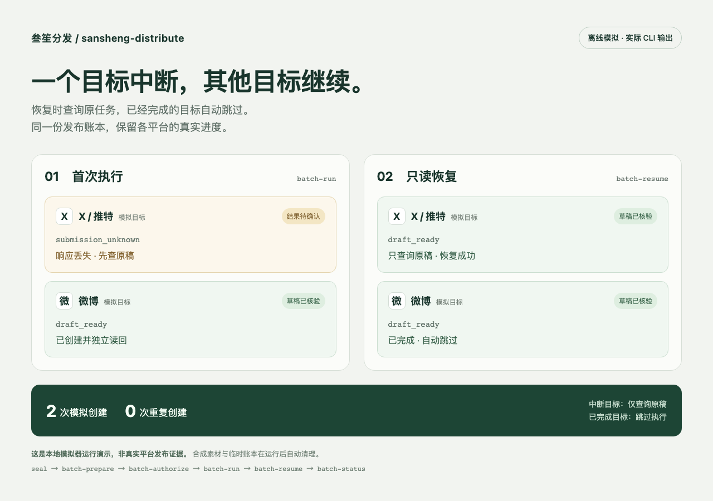

# sansheng-distribute · 叁笙分发

**把定稿交给 Agent，按平台发布、核验，并在中断后继续。**

[English](#english) · [使用入口](SKILL.md) · [版本记录](CHANGELOG.md)

[](LICENSE)
[](https://github.com/sanshengai/sansheng-distribute/stargazers)
[](https://github.com/sanshengai/sansheng-distribute/commits/main)

**实验版。** 已完成公众号真实草稿的 API 建稿、网页插入音视频、保存重开与官方读回测试；这不等于验证了所有账号，也不等于已测试公开发表或群发。部分视频平台已有单账号实测，具体范围见[平台能力与证据](references/platforms.md)；新预填助手与 CLI 路线另行验收。本项目不承诺安装后全平台一键发布。

## 它帮你做什么

文章和视频准备好后，发布仍有很多细节：平台文案、封面、上传位置、草稿状态，以及“刚才点了发布，到底成功没有”。叁笙分发把这些步骤交给 Agent，并保存每个平台的进度。

- **接收定稿**：生产端提供文字、图片、视频及文章内音视频的插入位置。
- **检查发布包**：核对素材、目标平台、账号、终点与版本；不代替作者重新创作。
- **组织多平台任务**：每个平台保留自己的状态，一个目标出错不阻止其他目标；完成的目标不重复执行。
- **独立读回**：上传完成、等待审核、草稿就绪和公开发布分别记录。
- **继续原任务**：结果未知时先查询原稿，避免因超时再次建稿。
- **计量执行耗时**：从同一账本查询执行与核验时间，复盘效率；范围与限制见[耗时计量](references/metrics.md)。

本项目是 Agent Skill，不是需要常驻的新桌面 App。浏览器步骤使用当前 Agent 已获准的工具；登录、验证码或平台验证确需本人时才请作者介入。

## 装之前先看产出



上图由下面的演示脚本实际运行报告生成。它调用本项目真实 CLI，但远端由临时本地模拟器替代，**不是 X 或微博真实发布成功的证明**。一个模拟目标丢失建稿响应，另一个继续完成；随后只读恢复确认原稿，总计两次模拟创建、零次重发。

```sh
python3 examples/offline_demo.py
```

演示无需账号、网络或私有配置，运行结束自动删除临时素材与账本；stdout 输出可复核的 JSON 报告。

一次分发任务会给出逐平台报告。下表展示状态的含义，不是所有平台均已实测成功的声明：

| 状态 | 作者看到的结果 | 下一步 |
|---|---|---|
| `draft_ready` | 草稿内容已经核对 | 达到本次草稿终点 |
| `pending` | 仍在审核或还有编辑步骤 | 按报告继续查询或补齐 |
| `submission_unknown` | 提交结果暂时无法确认 | 查询原任务，禁止直接重发 |
| `prefilled` | 编辑页面已经填好 | 如约定需要，由作者最终点击 |

初始化后的本地诊断输出示例（未选择可选平台）：

```json
{
  "ok": true,
  "checks": [
    {"name": "python", "ok": true},
    {"name": "platform", "ok": true},
    {"name": "configuration", "ok": true}
  ],
  "local_only": true
}
```

诊断通过只证明本机配置通过检查；平台操作另行验收。完整字段见[批量任务](references/campaign.md)和[交接契约](references/handoff.md)。

## 平台与验证范围

| 平台 | 本版方向 | 实测边界 |
|---|---|---|
| 微信公众号 | API 草稿，必要时网页补音视频 | 已通过真实测试稿；未验证公开发表、群发或全程 API 插入媒体 |
| X / 推特 | 包内文字/多图/视频预填；对应发送候选；文章接力 | 预填与只读续跑已实测；发送候选默认关闭，真实发送尚未验收，结果未知的尝试不重发 |
| 微博 | 包内文字/多图/视频预填及发送候选；Agent 接力 | 预填与独立续跑已实测；发送候选默认关闭，新帖发送未验收 |
| 抖音 | 视频网页流程、包内预填及发送候选 | 旧 Agent 流程有逐集投稿证据；包内预填已有实测，发送候选默认关闭。独立新窗口上传回执及定时预填仍待验收 |
| B 站 | 视频网页流程、包内受控 CLI | 旧 Agent 流程与单条 CLI 投稿有实测；新统一适配器已有登录和只读查询证据，真实上传尚未验收，默认关闭 |
| 小红书 | 图文或视频预填 | 真实账号尚未验收；最后点击由作者完成，受限账号只准备本地包 |
| 微信视频号 | 独立视频号目标、Agent 浏览器执行及独立读回 | 真实账号验收范围见能力表；与公众号、腾讯视频分开 |
| 腾讯视频 | 独立视频平台流程 | 真实账号尚未验收；不把微信视频号当作腾讯视频 |

平台页面会变化，账号权限也会不同。[能力与证据](references/platforms.md)是当前范围说明。初始化不会自动开放未验收能力，也不会替用户授权。

## 安装

需要 **macOS / Linux、Python 3.10+**，以及能读取 Skill、执行本机命令的 Agent。核心使用 Python 标准库，无需 Write。Windows 尚未支持。

```sh
git clone https://github.com/sanshengai/sansheng-distribute.git
cd sansheng-distribute
python3 setup.py --init
python3 setup.py --doctor
```

将该目录作为 Skill 安装到当前 Agent。Claude Code 也可以使用插件方式：

```sh
claude plugin marketplace add sanshengai/sansheng-distribute
claude plugin install sansheng-distribute@sansheng-distribute-marketplace
```

Codex、Claude Code、Antigravity、Grok Build 可共享同一份本体，但要使用各自的 Skill 安装入口；安装后在新会话验证能够发现 `sansheng-distribute`。当前跨 Agent 的执行验收并未全部完成，不能把“入口可读”理解为浏览器发布已经通过。

### 国内下载

直连不畅时，可以尝试公共代理下载公开源码：

```sh
git clone https://gh-proxy.com/https://github.com/sanshengai/sansheng-distribute.git
```

公共代理可用性不保证；不要通过公共代理传递私有仓凭证或平台账号信息。

## 快速上手

安装后对 Agent 说：

> 用叁笙分发检查这篇定稿和视频。公众号只建草稿，小红书只预填；先整理各平台发布包，沿用我已经确认的授权范围。

Agent 应先读取本 Skill，再接收生产端文件、媒体位置、账号和目标终点。检查本机配置：

```sh
python3 setup.py --show-profile
python3 setup.py
python3 setup.py --doctor
```

`setup.py` 提供交互引导；非交互用 `--init`。已有配置会被识别，不覆盖、不重建账本。`configured_modules` 只表示要配置或检查哪些模块；远端能力仍由 `enabled_capabilities` 和限定验收范围控制。

## 可选功能

所有平台模块默认关闭。关闭时仍能使用核心交接检查、任务管理与本地报告，也不会收到这些模块的缺配置告警。

| 模块 | 用途与所需条件 | 不启用时 | 新配置示例 |
|---|---|---|---|
| 公众号 | API 草稿；需账号凭证，API 模块已内置；媒体补齐需浏览器 | 不创建公众号草稿 | `python3 setup.py --init --platform wechat` |
| X | 当前 Agent 操作已登录浏览器 | 不操作 X | `python3 setup.py --init --platform x` |
| 微博 | 当前 Agent 操作已登录浏览器 | 不操作微博 | `python3 setup.py --init --platform weibo` |
| 抖音 | 视频素材、创作后台和 Agent 浏览器工具 | 不上传抖音视频 | `python3 setup.py --init --platform douyin` |
| B 站 | 视频素材、创作中心和 Agent 浏览器工具；可选固定CLI | 不上传 B 站视频 | `python3 setup.py --init --platform bilibili` |
| 小红书 | 图文/视频、浏览器；作者最终点击 | 不操作小红书 | `python3 setup.py --init --platform xiaohongshu` |
| 微信视频号 | 视频素材、视频号助手和 Agent 浏览器工具 | 不上传视频号视频 | `python3 setup.py --init --platform wechat_channels` |
| 腾讯视频 | 视频素材、独立创作后台和 Agent 浏览器工具 | 不上传腾讯视频 | `python3 setup.py --init --platform tencent_video` |

上表命令用于首次初始化，已有配置会拒绝覆盖。已初始化的用户按[配置说明](references/setup.md)显式编辑所选配置；不要为了添加平台另建一份空账本。公众号使用本包内置 API；旧配置显式指定的 `--write-scripts` 路径继续兼容，新安装不扫描或要求另装 Write。

新配置使用 `SANSHENG_DISTRIBUTE_PROFILE` / `SANSHENG_DISTRIBUTE_STATE`，兼容旧变量和原账本。秘密仅放环境变量或私有 env 文件，样例见 [.env.example](.env.example)；程序不会自动载入仓根 `.env`。新旧账本同时存在时必须显式选择，不能自动迁移。详见[安装与私有配置](references/setup.md)。

## 更新与开发

贡献代码前启用脱敏提交检查：`git config core.hooksPath .githooks`。不要提交账号配置、浏览器数据或真实稿件回执。

clone 安装在仓内执行 `git pull`；插件安装使用 `claude plugin marketplace update`，再执行 `claude plugin update sansheng-distribute`。更新后开启新 Agent 会话加载新说明。

查看 [CHANGELOG](CHANGELOG.md) 与 [Releases](https://github.com/sanshengai/sansheng-distribute/releases)，可用 GitHub 的 **Watch → Custom → Releases** 接收版本通知。

```sh
python3 -m unittest discover -s tests
```

测试使用合成素材和临时账本，不替代真实平台测试。报告问题时请删除账号凭证、cookie 和稿件正文，安全问题请按 [SECURITY.md](SECURITY.md) 私下反馈。

## 配套文章

本版的公开使用说明在本文及 `references/` 中，尚无独立的公众号讲解文章。

## English

**An experimental publishing handoff skill for AI agents.** Give it finished articles, images or videos, explicit destinations and media insertion positions. It validates the package, tracks each destination separately, verifies remote results and resumes interrupted work without blindly submitting again.

**Experimental.** A real WeChat Official Account draft has passed API creation, browser insertion of audio/video, save/reopen and official API readback. Public publication, mass messaging and an entirely API-based media workflow have not been validated. Some video platforms have single-account acceptance evidence; see [platform evidence](references/platforms.md). The new optional prefill helper and CLI route require separate acceptance. This is not a promise of universal one-click publishing.

The core requires **macOS/Linux and Python 3.10+**, uses the standard library and does not require Write. WeChat API drafts use the bundled module; an explicitly configured legacy Write module remains supported. Browser actions rely on the current agent's authorized browser tools. Xiaohongshu stops at a draft or prefilled page; the author makes the final click.

```sh
git clone https://github.com/sanshengai/sansheng-distribute.git
cd sansheng-distribute
python3 setup.py --init
python3 setup.py --doctor
```

Register the repository with your agent's Skill installation mechanism, or use the Claude plugin commands shown above. Agent discovery and actual browser execution are separate acceptance criteria.

All optional platform modules start disabled. Use interactive `python3 setup.py` or choose a module with `--init --platform wechat` (or `x`, `weibo`, `douyin`, `bilibili`, `xiaohongshu`, `tencent_video`, `wechat_channels`). Initialization refuses to overwrite an existing profile and does not grant publishing permissions. Existing users edit their selected profile explicitly; do not create a fresh ledger to add a platform.

`--show-profile` reveals selected paths only. `--doctor` checks local requirements for selected modules only; it makes no API requests. Use `SANSHENG_DISTRIBUTE_PROFILE` and `SANSHENG_DISTRIBUTE_STATE` for explicit paths. Legacy configuration is preserved; ambiguous old/new ledgers require an explicit choice. Secrets belong in the environment or a private env file, never in a publishing package or Git.

See [setup](references/setup.md), [handoff](references/handoff.md), [campaigns](references/campaign.md), [recovery](references/recovery.md) and [acceptance](references/acceptance.md). Reference documentation is primarily Chinese. Update a clone with `git pull`; release notes are in [CHANGELOG](CHANGELOG.md).

## 关于作者 · About the author

<p align="center">
  <a href="https://sanshengai.top"><strong>🌐 网站 sanshengai.top</strong></a> ·
  <a href="https://namecard.xiaoyuzhoufm.com/nnl8x"><strong>🎧 小宇宙</strong></a> ·
  <a href="https://weibo.com/u/7546221967"><strong>微博</strong></a> ·
  <a href="https://sanshengai.top/go/xiaohongshu"><strong>小红书</strong></a> ·
  <a href="mailto:sandypoli@gmail.com"><strong>✉️ 邮箱</strong></a>
</p>

我是**叁笙**，一个用 AI 做内容、也用 AI 造工具的人。我在个人站「[叁笙早安 AI](https://sanshengai.top)」分享 AI 资讯、长文，以及自己使用的读书、写作和创作工具。

这些 Skill 来自实际工作中反复打磨的流程。把可复用的部分清洗、脱敏后开源，是希望它们也能帮你少做一些重复工作。你可以直接使用，也欢迎改成自己的工作方式。

I'm **sansheng**, a creator building content and tools with AI. These skills grow out of my own workflows and are shared so others can reuse and improve them.

欢迎来网站看看，或扫码关注公众号「叁笙早安AI」：

<p align="center">
  
  <br><sub>微信扫码关注 · 叁笙早安AI</sub>
</p>

## 致谢与依赖 · Credits & Dependencies

- [宝玉 / baoyu-skills](https://github.com/JimLiu/baoyu-skills)：借鉴公众号、X 与微博的发布流程；审阅版本采用 MIT。未捆绑上游执行代码。
- [dreammis / social-auto-upload](https://github.com/dreammis/social-auto-upload)：多平台视频上传的调研来源；审阅仓库采用 MIT，总 Skill 标注 MIT-0。本项目不捆绑或默认安装该工具，也不把其微信视频号适配当作腾讯视频支持。
- [sansheng-write](https://github.com/sanshengai/sansheng-write)（MIT）：内置公众号 API 与白名单出口模块的来源，保留 MIT 许可与文件来源锁；文章创作和排版仍由生产端负责。
- [sfdenibao / social-publish-mcp](https://github.com/sfdenibao/social-publish-mcp) 与 [rehatRobot / omnipost](https://github.com/rehatRobot/omnipost)（MIT）：提交前记账、调度与平台字段的源码对照来源；不捆绑其服务、队列或上传器。
- [xpzouying / xiaohongshu-mcp](https://github.com/xpzouying/xiaohongshu-mcp)（Apache-2.0）：登录、上传、话题与提交边界的审查来源；不捆绑或调用其最终发布路径，也不据此承诺免风控。

Reviewed upstream revisions and adoption scope are recorded in [sources.json](references/sources.json). Bundled WeChat modules retain their MIT attribution in [THIRD_PARTY_NOTICES.md](THIRD_PARTY_NOTICES.md). Other reviewed publisher projects are not bundled as separate Skills or services. Optional browser dependencies and the pinned Bilibili tool are prepared through this package's setup entrypoint.

## License

[MIT](LICENSE) © 2026 叁笙 (sansheng)
